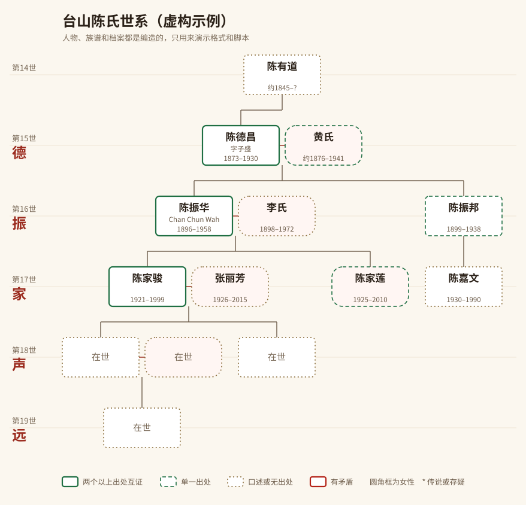

# xungen (寻根)

An Agent Skill for Chinese family history. It helps an AI agent organise elders' memories and old genealogies (jiapu), convert reign-era and sexagenary dates, match ancestral places to today's map, find Chinese genealogies and overseas Chinese immigration records, and draw the family tree. Every claim carries a source; when nothing is found, it says so.

[中文](README.md)



The tree above is generated by `family.py` from a JSON file; the family is fictional. Solid boxes have two or more sources, dashed boxes one, dotted boxes only oral accounts. Living people are hidden automatically.

## Why

Chinese family history is hard for three reasons. Records are scattered across clan genealogies, local gazetteers, archives and overseas immigration files. Dates like 光绪庚子 and places like 新宁县 / "Sunning" need converting before anything lines up. And a plain chatbot will happily attach your family to a famous ancestor or invent an archive reference.

This skill gives the agent a researcher's method: start with the family, follow the evidence, keep original records, transcriptions and oral accounts apart, never merge two people just because they share a name, flag remote ancestors and migration legends, and protect living people.

## What it covers

- **Interviews**: questions for elders and a checklist of things to photograph at home (genealogies, gravestones, household registers, qiaopi remittance letters, old photos).
- **Dates**: Ming, Southern Ming and Qing reign eras, the Republic of China calendar, Japanese eras used in Taiwan records, Manchukuo, sexagenary years, zodiac animals and nominal age (虚岁). It flags era/cyclical-year conflicts and lunar dates that fall in the next Gregorian year.
- **Places**: old county and village names mapped to today's, and Cantonese spellings in foreign records (Sunning, Hoiping, Heungshan…) mapped back to Chinese.
- **Names**: genealogy names, courtesy names, generation poems (字辈), "某氏" wives, adoption, uxorilocal marriage, and how names were romanised abroad.
- **Sources in China**: Shanghai Library and National Library genealogies, FamilySearch's China Collection of Genealogies, local gazetteers, CBDB, archives, martyr registers, qiaopi, Japanese-era household registers in Taiwan.
- **Overseas Chinese records**: Australia (RecordSearch, CEDT files), Canada (head tax registers), the United States (Chinese Exclusion Act case files), Singapore (genealogies and old newspapers).
- **Evidence**: statuses from corroborated to contradicted, and common traps: famous-ancestor claims, merged clan genealogies, migration legends such as the Big Locust Tree and Zhuji Lane, paper sons.
- **Output**: a research report, an SVG family tree, a generation table, a GEDCOM file for Gramps, MyHeritage and other software, and draft letters to archives and clan associations.

## Install

With the [skills](https://github.com/vercel-labs/skills) CLI, for Claude Code, Codex and other agents that support Agent Skills:

```bash
npx skills add https://github.com/DU8866-nice/xungen --skill xungen
```

Add `--global` to install it for your user. Or copy it by hand:

```bash
git clone https://github.com/DU8866-nice/xungen.git
cp -r xungen/skills/xungen ~/.claude/skills/     # Claude Code
cp -r xungen/skills/xungen ~/.codex/skills/      # Codex
```

For the Claude app, zip the `skills/xungen` folder and upload it under Skills in settings.

## Usage

Ask in plain language, in Chinese or English:

```
My great-grandfather was Chan Chun Wah from Toishan. He was in Sydney in the 1910s and went back to China. Where do I start?
```

```
Here are photos of a few pages of our jiapu. Turn them into a family tree and tell me what doesn't add up.
```

The skill's instructions are in Chinese; the agent answers in your language.

## Scripts

Both scripts use only the Python standard library.

```bash
python3 skills/xungen/scripts/when.py 光绪廿六年岁次辛丑 民国三十八年 虚岁73 --ref 2026
python3 skills/xungen/scripts/family.py check family.json
python3 skills/xungen/scripts/family.py all family.json -o out/
python3 skills/xungen/scripts/family.py all family.json -o share/ --public   # hides living people
```

The data format is in [data-format.md](skills/xungen/references/data-format.md) (Chinese). A full fictional example, with a research report, is in [examples/chen-taishan](examples/chen-taishan).

## Principles

- No invented names, dates, sources or archive references. When nothing is found, it lists where it looked.
- No famous ancestors without contemporary records.
- Living people stay private; shareable versions hide them.
- Letters to archives and clan associations are drafts; you decide whether to send them.
- Paid, login-only or real-name sites: it tells you how to use them and you do it yourself.

Links and access rules were checked in November 2026. Records for the Philippines, Indonesia, Thailand, Vietnam and Latin America are not covered yet. Contributions welcome.

## Tests

```bash
python3 -m unittest discover -s tests -v
```

## License

[MIT](LICENSE)
