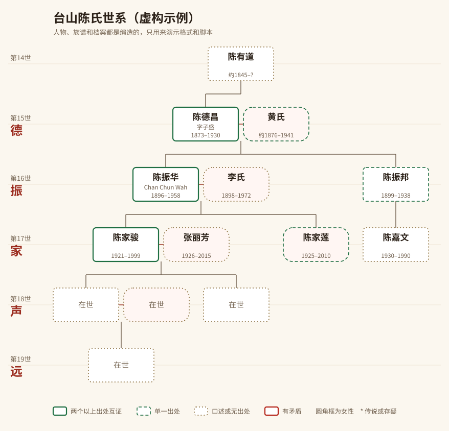

# 寻根 xungen

一个 Agent Skill，让 AI 帮你查家族史：整理长辈的口述和老族谱，换算年号干支，把祖籍对到今天的地名，告诉你去哪里查国内家谱和海外华人移民档案，最后画出世系图。每条结论都标出处，查不到就说查不到。

[English](README.en.md)



上图由 `family.py` 从一份 JSON 生成，家族是虚构的。实线框有两个以上出处，虚线框只有一个，点线框只有口述；在世的人自动隐去。

## 为什么做这个

查家史难在三件事：资料散在族谱、地方志、档案馆和海外移民档案里；“光绪庚子”“民国卅八年”“新宁县”“Sunning”都要换算才能对上；直接问 AI，它很容易把名人接到你家谱上，或者编出不存在的档案号。

这个 skill 给 AI 一套家史研究的做法：先问家里，再按证据查；原始记录、转录和口述分开记；同名同姓不乱合并；远祖和迁徙传说单独标出；在世的人不外泄。

## 能做什么

- **长辈访谈**：问题清单和家中实物清单（族谱、墓碑、户口簿、侨批、老照片），访谈记录怎么整理。
- **纪年换算**：明、南明、清的年号，民国，台湾日治时期的日本年号，满洲国年号，干支、生肖、虚岁，都能换算到公历年份。年号和干支对不上、农历年底跨年时会提醒。
- **地名定位**：旧地名对到今天的县和村，海外档案里的粤语拼法（Sunning、Hoiping、Heungshan……）对回中文。
- **名字和字辈**：谱名、字号、“某氏”、过继、入赘、谱中用语，海外档案里的拼写。
- **国内资料**：上海图书馆和国家图书馆的家谱、FamilySearch 中国家谱、地方志、CBDB、档案馆、烈士名录、侨批、台湾日治户籍。
- **海外华人档案**：澳洲 CEDT 和 RecordSearch、加拿大人头税登记、美国排华法案档案、新加坡族谱和旧报纸。
- **证据分级**：互证、单一来源、口述、推测、有矛盾；攀附名人、联宗统谱、大槐树和珠玑巷等迁徙传说、纸生仔等常见陷阱。
- **输出**：研究报告、世系图 SVG、世系表、能导入 Gramps 和 MyHeritage 等软件的 GEDCOM，以及写给档案馆、宗亲会的信件草稿。

## 安装

用 [skills](https://github.com/vercel-labs/skills) 命令行安装，Claude Code、Codex 等支持 Agent Skills 的工具都能用：

```bash
npx skills add https://github.com/DU8866-nice/xungen --skill xungen
```

加 `--global` 装到用户目录。也可以手动复制：

```bash
git clone https://github.com/DU8866-nice/xungen.git
cp -r xungen/skills/xungen ~/.claude/skills/     # Claude Code
cp -r xungen/skills/xungen ~/.codex/skills/      # Codex
```

在 Claude 应用里用的话，把 `skills/xungen` 文件夹压缩成 zip，在设置的 Skills 里上传。

## 用法

直接跟 AI 说：

```
我想查我太公的事。只知道他叫陈振华，台山人，民国初年去过澳洲，后来回乡了。从哪里开始？
```

```
这是我家族谱的几页照片，帮我整理成世系，看看哪些地方对不上。
```

```
墓碑上写“光绪廿六年岁次辛丑三月初五生”，是哪一年？
```

```
春节要回老家，帮我准备问爷爷奶奶的问题。
```

它会先问清楚你要解决的问题和已知信息，再一步步整理、查找、评估，最后交给你报告和世系图。

## 脚本

两个脚本都只用 Python 标准库，可以单独运行。

```bash
$ python3 skills/xungen/scripts/when.py 光绪廿六年岁次辛丑 民国三十八年 虚岁73 --ref 2026
光绪廿六年岁次辛丑 → 1900 年（庚子，属鼠）  [清·光绪]
  - 记载的干支是辛丑，但 1900 年是庚子，两者矛盾，要么年数抄错，要么干支抄错，回原件核对。
民国三十八年 → 1949 年（己丑，属牛）  [中华民国·民国]
虚岁73 → 1954 年（甲午，属马）
  ...
```

```bash
python3 skills/xungen/scripts/family.py check family.json              # 检查关系、辈分、字辈、年份、出处
python3 skills/xungen/scripts/family.py all family.json -o out/        # 世系图、世系表、GEDCOM、检查结果
python3 skills/xungen/scripts/family.py all family.json -o share/ --public   # 隐去在世者，用于分享
```

数据格式见 [data-format.md](skills/xungen/references/data-format.md)。完整的虚构示例在 [examples/chen-taishan](examples/chen-taishan)，包括[研究报告](examples/chen-taishan/report.md)、[世系表](examples/chen-taishan/tree.md)和[检查结果](examples/chen-taishan/check.md)。

## 原则

- 不编造人名、年份、出处和档案号，查不到就写查过哪里。
- 不把家族接到古代名人身上，除非有同时代记录。
- 在世的人不外泄，分享版自动隐去。
- 写给档案馆、宗亲会的信只起草，由你决定发不发。
- 需要付费、注册、实名的网站，告诉你怎么用，由你自己操作。

## 资料入口

链接和规则核对于 2026 年 11 月，各机构可能调整。发现失效或变化，欢迎提 issue。

| 方面 | 文件 |
|---|---|
| 访谈 | [interview.md](skills/xungen/references/interview.md) |
| 名字和字辈 | [names.md](skills/xungen/references/names.md) |
| 地名 | [places.md](skills/xungen/references/places.md) |
| 纪年 | [dates.md](skills/xungen/references/dates.md) |
| 国内资料 | [sources-china.md](skills/xungen/references/sources-china.md) |
| 海外华人档案 | [sources-overseas.md](skills/xungen/references/sources-overseas.md) |
| 证据和陷阱 | [evidence.md](skills/xungen/references/evidence.md) |
| 隐私 | [privacy.md](skills/xungen/references/privacy.md) |
| 报告和信件模板 | [report.md](skills/xungen/references/report.md) |

菲律宾、印尼、泰国、越南、拉美等地的华人档案还没有整理，欢迎补充。

## 测试

```bash
python3 -m unittest discover -s tests -v
```

## 参与

见 [CONTRIBUTING.md](CONTRIBUTING.md)。最需要的是：各地档案和家谱收藏的查询经验、海外华人档案的入口、`when.py` 还不认识的纪年写法。

## 许可证

[MIT](LICENSE)
