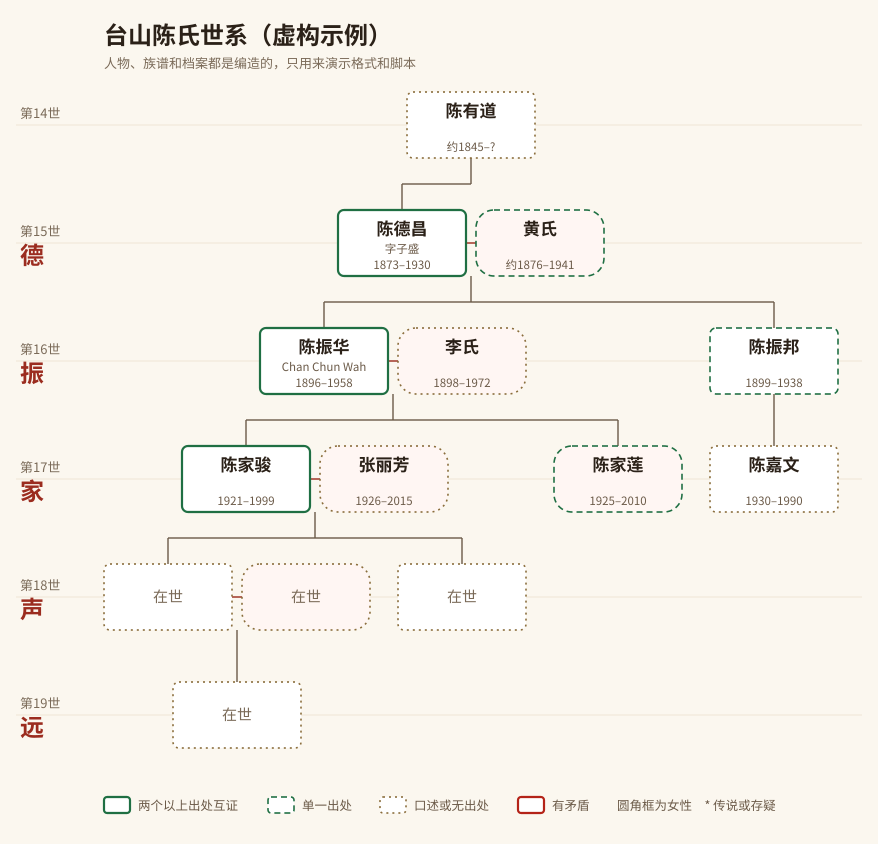

# 台山陈氏家史研究报告（虚构示例）

> 这是演示用的虚构家族。人物、族谱、墓碑、档案都是编造的，不对应任何真实的人和档案。

2026 年 11 月 · 研究问题：曾祖父陈振华在澳洲的经历，以及他往上几代的名字和祖籍。

## 结论

陈振华（1896–1958）是第 16 世，“振”字辈，父亲陈德昌（1873–1930），祖父陈有道（约 1845 年生）。家族祖籍是广东新宁县（1914 年改名台山县）某村。陈振华 1914 年前后到澳洲悉尼，1937 年回乡，这段经历有族谱、澳洲档案和家藏侨批三方互证。陈有道只有口述，还需要书面记录。

## 世系图

在世的人在分享版里只显示“在世”。

## 逐代说明

### 第 14 世 陈有道

- 生年：约 1845 年，祖籍新宁县某村（出处 s5，大伯口述）
- 证据状态：口述。族谱这一页缺损，需要找墓碑或祠堂神主牌印证。

### 第 15 世 陈德昌，字子盛

- 生卒：1873–1930（族谱“同治十二年”生，墓碑“民国十九年立”；出处 s1、s2）
- 配黄氏，约 1876–1941（s1）
- 证据状态：互证

### 第 16 世 陈振华（Chan Chun Wah）

- 生卒：1896–1958（族谱“光绪二十二年”生；s1）
- 出洋：1914 年到澳洲悉尼，1937 年回乡（族谱、澳洲档案、侨批 11 封；s1、s3、s4）
- 配李氏，1898–1972（s5，口述）
- 证据状态：互证

## 矛盾和未解决的问题

- 陈嘉文（1930–1990）：口述说是陈振邦的儿子，但名字不合“家”字辈，族谱里也没找到。可能是“家文”的同音误写，也可能另有谱名。下一步看陈振邦一支的墓碑。

## 传说

- 族谱序言说始祖于南宋自南雄珠玑巷迁来。没有同时代记录，按传说处理，见 references/evidence.md。

## 查过但没找到

- 族谱卷三中陈有道的生卒（该页缺损）。
- 陈振华在悉尼的出生、婚姻登记：他在国内成婚，澳洲不会有。

## 下一步

1. 清明回乡时拍下陈有道的墓碑和祠堂神主牌。
2. 在侨批信封上找陈振华在悉尼的商号地址，再查当年的旧报纸。
3. 问二伯是否记得李氏娘家在哪个村。

## 出处

见 [tree.md](tree.md) 末尾的出处表。
